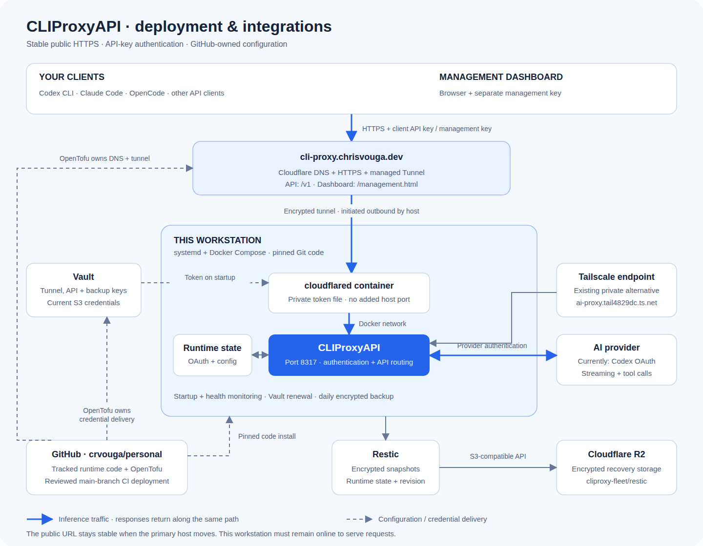

# CLIProxyAPI fleet service

`@pkgs/cliproxy-fleet` owns the source for the authenticated CLIProxyAPI deployment. The package contains Compose configuration, immutable upstream image pins, launchd agents for the manager, legacy systemd units, operational scripts, client bootstrap code and recovery procedures. It is private and is not published to npm or as a custom container image.

## Deployment diagram



[Open the scalable diagram](docs/deployment.svg).

## Fleet roles: the manager hosts the proxy

The fleet has exactly two roles (see `packages/fleet/definition.json`, version 3). The **manager** is the singleton macOS MacBook Air (`manager.id`, `chriss-macbook-air`). It runs fleet-sync and hosts every singleton service, including this proxy, with Docker Desktop and per-user launchd agents (no sudo). **Workers** (the Ubuntu boxes) are stateless clients: they use the endpoint and never host the proxy. There is no separate `proxy.owner`; the proxy owner is always `manager.id`.

Availability follows the manager: while it sleeps, is offline or is logged out, workers have no proxy (use plain native clients). Fleet policy keeps the manager awake on AC power (`manager.neverSleepOnPower`), and the manager must stay logged in because launchd agents and Docker Desktop run in the user session. Enable Docker Desktop's **Start Docker Desktop when you sign in**.

The proxy still runs on the Linux worker `chris-vouga-ms-a2` (systemd, `/opt/cliproxy-fleet`) until the operator-approved move in [migration](docs/migration.md#move-the-proxy-from-a-linux-worker-to-the-manager). The Linux systemd backend is legacy: keep it only to fence, back up and decommission that host.

## Source and installed artifacts

The only executable source is Git-tracked code in `crvouga/personal`. Installation creates a detached sparse Git worktree at `INSTALL_ROOT/revisions/COMMIT`; operational paths under `INSTALL_ROOT` and the launchd agents (or legacy systemd units) are links into that worktree. `INSTALL_ROOT` is `~/Library/Application Support/cliproxy-fleet` on the manager and `/opt/cliproxy-fleet` on the legacy Linux host; `CLIPROXY_ROOT` overrides it for commands (the tracked LaunchAgents always use the default manager root). No executable source is rendered or copied outside Git. Client launchers are also links to the tracked `clients/launcher.py` in a checkout.

`INSTALLATION.json` records the worktree, commit and hashes. `audit` verifies Git tracking, a clean deployed checkout, link targets, unit links (`~/Library/LaunchAgents` plus loaded `gui/$UID` agents on the manager; `/etc/systemd/system` on Linux), content hashes and unexpected code. Startup and monitoring enforce it. Uncommitted code is never installed; keep the original Git repository/common object database available, or rebuild a deployment worktree from a fresh clone during recovery.

- **Git:** all executable code, Compose/templates, immutable image pins, unit definitions, clients, tests and runbooks.
- **Vault:** provider-independent credentials and existing recovery keys; never commit secrets.
- **Encrypted R2 snapshots:** live provider/config state, dedicated Tailscale identity and source-revision metadata.
- **Generated non-code data:** private client settings, installation metadata and `.env` image-pin data; their generators are tracked. Runtime data remains separate under `state/`.

## Stable public HTTPS

The canonical public API is `https://cli-proxy.chrisvouga.dev/v1` and the dashboard is `https://cli-proxy.chrisvouga.dev/management.html`. Clients send the existing client API key as a bearer token; management requires its separate key. No browser login or Tailscale client is required for this hostname. The existing private `https://ai-proxy.tail4829dc.ts.net` endpoint remains available.

The foundation OpenTofu root owns the Cloudflare tunnel, remotely managed ingress and proxied DNS. The vault root owns the isolated `secret/cliproxy-fleet/tunnel` document. Both are declared in the canonical inventory. No local script provisions them. The pinned cloudflared container shares the proxy's Compose network and connects outbound, with no additional public host port.

After the reviewed main-branch deployment creates these resources, enable the local connector:

```bash
bun run cliproxy public-endpoint enable
bun run cliproxy public-endpoint verify
python3 -B packages/cliproxy-fleet/clients/bootstrap.py \
  --endpoint https://cli-proxy.chrisvouga.dev --model gpt-6.1-sol
```

`enable` records runtime intent; subsequent service starts fetch the current token from Vault before recreating the connector. The token is mounted from a private file, never passed in arguments or copied into source. It is excluded from backups because recovery fetches it from Vault. To reload a rotated token, run `bun run cliproxy public-endpoint start`. `disable` stops only the public connector and removes the startup marker. The private endpoint is independent.

This hostname routes to whichever host runs the connector (the manager after the move); it does not move compute into Railway or provide availability when that host is off. During migration, stop the old host, restore on the manager, and enable the connector there. DNS remains unchanged. Never run competing proxy/provider-state copies.

## Install, update and rollback

Manager (macOS) requirements: Docker Desktop (running) and the shared mise toolchain. `packages/cliproxy-fleet/scripts/install-dependencies` (never sudo on macOS) builds `INSTALL_ROOT/tools`: a venv on the pinned mise Python with hash-locked PyYAML (`requirements.lock`) plus the pinned, checksum-locked `restic` from `mise.lock`. Every LaunchAgent puts `tools/bin` first on `PATH`, so jobs never depend on whatever happens to be installed on the Mac. Homebrew is not used. Legacy Linux: `sudo packages/cliproxy-fleet/scripts/install-dependencies` installs the Ubuntu packages.

From the repository root on the manager, after committing/reviewing the package revision:

```bash
bun run cliproxy install --dry-run
bun run cliproxy install --revision HEAD
bun run cliproxy audit
bun run cliproxy status
```

On the manager the installer runs as the logged-in user (never sudo). It links the tracked `launchd/*.plist` agents into `~/Library/LaunchAgents`, reloads them with `launchctl bootout`/`enable`/`bootstrap gui/$UID`, and starts the stack through the same `service-start` script the service agent runs. It records the installing user's UID/GID in the generated `.env` so containers own their bind-mounted state; the legacy Linux host keeps UID/GID 1000. It stops with `DOCKER_DESKTOP_NOT_RUNNING` (or `DOCKER_CLI_MISSING`) when Docker Desktop is unavailable. On Linux the installer still uses sudo and systemd.

| launchd label (manager)                | systemd unit (legacy Linux)   | Schedule                        |
| -------------------------------------- | ----------------------------- | ------------------------------- |
| `dev.chrisvouga.cliproxy-fleet`        | `cliproxy-fleet.service`      | at load/login; retried on error |
| `dev.chrisvouga.cliproxy-monitor`      | `cliproxy-monitor.timer`      | every 5 minutes                 |
| `dev.chrisvouga.cliproxy-vault-renew`  | `cliproxy-vault-renew.timer`  | at load, then every 15 minutes  |
| `dev.chrisvouga.cliproxy-backup`       | `cliproxy-backup.timer`       | minutes 0, 15, 30, 45           |
| `dev.chrisvouga.cliproxy-backup-check` | `cliproxy-backup-check.timer` | Sunday 05:00                    |
| `dev.chrisvouga.cliproxy-gc`           | `cliproxy-gc.timer`           | Sunday 04:00                    |

Backup, backup-check and GC agents load only after `recover`/`verify-recovery` confirms the independent Restic password. launchd has no stop hook: `bun run cliproxy stop` stops containers; `launchctl bootout gui/$UID/LABEL` unloads an agent. launchd runs missed calendar jobs after wake but has no jitter or GC retry; failures stay visible through status markers and the monitor.

The installer preserves the live configuration and credentials, refreshes managed files/units, and restarts only this stack. It never provisions cloud resources or writes Vault secrets. On a fresh host, first use the restore procedure below; do not create a competing active instance with copied credentials.

To update, change the package/image pins in Git, pass package/repository checks, commit, and install the selected revision. To undo a Git revision/image update:

```bash
bun run cliproxy install --rollback
# Or explicitly install a previously reviewed package commit:
bun run cliproxy install --revision PREVIOUS_COMMIT
```

The previous installation revision is recorded separately. Image rollback cannot undo application state migrations; restore a compatible pre-upgrade snapshot when needed. `.env` is generated, so image changes go through `image.lock.json`, not local edits.

## Architecture and endpoints

One upstream CLIProxyAPI v8.0.55 container runs as the manager user's UID/GID (1000 on the legacy Linux host) with a read-only root filesystem, no extra capabilities, bounded CPU/memory/processes and rotated Docker logs. Only `127.0.0.1:8317` is published. A separate nonprivileged userspace Tailscale container proxies over the Compose bridge and keeps its own tagged identity. It does not replace the manager's own Tailscale identity or change SSH/firewall settings. The upstream official dashboard is pinned and checksum-verified; background updates are disabled.

- Stable private origin: **https://ai-proxy.tail4829dc.ts.net**
- OpenAI/Responses base: **https://ai-proxy.tail4829dc.ts.net/v1**
- Official dashboard: **https://ai-proxy.tail4829dc.ts.net/management.html**
- Stable tailnet resource: `svc:ai-proxy`, `tcp:443`; host identity: `tag:ai-proxy`.

Inference requires a client API key. Management uses a separate key; ordinary inference keys cannot authorize admin APIs. HTML is publicly reachable; management data/actions require authentication. Existing broader tailnet policy grants remain in force; application authentication is always enforced. The public hostname uses the OpenTofu-managed Cloudflare tunnel; Tailscale Funnel is not used.

Cloud service definitions, policies and Vault values belong to the OpenTofu platform workflow. The original one-off cloud provisioning/secret-writing helpers have been retired. Do not recreate them in this package. Existing Tailscale Service resources survive workstation replacement; local `activate` advertises an existing resource and is a runtime operation. See [cloud adoption notes](docs/cloud-adoption.md) before changing the cloud definitions.

## State, permissions and configuration

`INSTALL_ROOT/state/` is mode 0700. On the manager it is owned by the installing user; on the legacy Linux host restricted files are owned by numeric UID 1000. The inference container mounts only `state/runtime`; it cannot access backup secrets, the Docker socket or dedicated Tailscale state.

| Path under installation     | Purpose                                                                |
| --------------------------- | ---------------------------------------------------------------------- |
| `state/runtime/config.yaml` | Working config cache; dashboard edits checkpoint to R2                 |
| `state/runtime/auths/`      | Provider OAuth, account metadata, bbolt store, cooldown state          |
| `state/runtime/static/`     | Pinned official management HTML                                        |
| `state/secrets/`            | Private local material read from Vault and renewable Vault login token |
| `state/tailscale/`          | Dedicated service identity; never run two copies concurrently          |
| `state/network/`            | Legacy policy cache; not required for recovery                         |
| `state/endpoint.json`       | Verified stable endpoint metadata                                      |
| `state/status/`             | Operational results and shared operation lock                          |
| `INSTALLATION.json`         | Git revision and hashes of generated installed code                    |

`config.template.yaml` is a versioned starting policy, not a second live config. Initialization never overwrites an existing live config. Dashboard edits persist in the directory mount and hot-reload. Reconcile intended nonsecret policy changes into the Git template manually; never commit a credential-bearing config export. CLI updates use `apply FILE`: safety validation and credential-free isolated container staging before replacement/restart. Upstream has no exhaustive standalone config checker; staging does not prove every provider option is valid.

## Routine commands

Run these from the repository; operational commands use the installed revision's scripts:

```bash
bun run cliproxy audit
bun run cliproxy start
bun run cliproxy stop
bun run cliproxy restart
bun run cliproxy status
bun run cliproxy health
bun run cliproxy models
bun run cliproxy logs
bun run cliproxy validate
bun run cliproxy apply /protected/candidate.yaml
```

Docker restart policy recovers process crashes. On the manager the service agent starts the stack at login (Docker Desktop must be running; failed starts retry every minute); the legacy systemd unit starts at boot. A health probe checks HTTP/auth reachability, and the five-minute monitor checks code provenance, application/admin authentication, backup freshness and Vault failures. Persistent unhealthy states are surfaced, not hidden by automatic restart loops. `logs` is best-effort redaction; keep debug and request logging disabled. Off-machine verification runs in GitHub Actions; notification delivery follows GitHub notification settings.

## Providers and model selection

One OpenAI/Codex account was explicitly authorized during the initial deployment. Native coding-client OAuth files were not imported. Anthropic and Google require their own supported authorization/API-key setup in the official dashboard. All provider credentials stay server-side.

```bash
bun run cliproxy add-account codex
bun run cliproxy add-account claude
bun run cliproxy models
bun run cliproxy inference responses EXACT_CODEX_MODEL_ID
bun run cliproxy inference messages EXACT_CLAUDE_MODEL_ID
```

Codex uses the upstream device-code flow. Remote callback flows may require the documented dashboard callback flow or temporary SSH loopback forwarding; callback ports are not exposed by default. This pinned version has no generic Gemini CLI login flag; use its supported dashboard/API-key integration. Provider rules still govern permissible account use.

Routing is **fill-first** (`routing.strategy: fill-first`): one account serves until its quota is exhausted and it cools down, then the next account, with session affinity keeping a session on its account while available and bounded retries across eligible accounts for the requested model. `cliproxy apply` requires this policy and the host monitor reports drift; see [Multi-account routing](docs/model-health.md#multi-account-routing-fill-first) for applying it to a running proxy. Automatic preview-model switching is disabled. No model aliases are configured: clients use the upstream model ids exactly as `/v1/models` lists them. [`models.json`](models.json) declares the model ids that are health-checked (`claude-opus-5-5`, `claude-sonnet-5-5`, `gpt-6-astra`, `gpt-6.1-sol`), and the checks fail loudly when one is not served. Usage statistics are enabled but are not a durable billing ledger. Available quota details depend on the provider.

## Fleet clients: macOS, Ubuntu and Windows/WSL

Use the same versioned bootstrap from this repository on every machine. Requires Python 3 and the desired client installed via the shared toolchain. No remote machine is changed automatically.

```bash
python3 packages/cliproxy-fleet/clients/bootstrap.py \
  --endpoint https://ai-proxy.tail4829dc.ts.net \
  --model gpt-6.1-sol
python3 packages/cliproxy-fleet/clients/bootstrap.py --validate
~/.local/bin/codex-fleet
~/.local/bin/opencode-fleet
```

Enter the inference key at the hidden prompt. It is available in Vault `secret/personal/prd:CLIPROXY_FLEET_CLIENT_API_KEY`; dashboard login uses `CLIPROXY_FLEET_MANAGEMENT_KEY`. Secrets never appear in command arguments. Keys are saved mode 0600 and loaded only into child environments. Give runners separate revocable inference keys where needed, never provider OAuth credentials or the admin key.

Codex uses custom-provider CLI overrides and Responses HTTP/SSE. Claude uses its supported base URL/auth-token variables and an explicit Claude model. OpenCode uses its config-file override, with separate Responses and Anthropic SDK providers. Once Claude is authenticated, rerun with `--claude-model MODEL_ID`; otherwise the Claude launcher fails with an explicit setup requirement. Native client config files are preserved. Use plain native clients during a proxy outage.

Run bootstrap from a repository checkout containing `clients/launcher.py`; detached downloaded bootstrap files are unsupported. Bootstrap is idempotent and refuses unrelated launcher collisions. `--uninstall` removes launcher links while retaining private settings for deliberate cleanup. On Windows run inside WSL; native PowerShell launchers are not provided. Validate from each actual machine and target repository because OpenCode merges project settings.

## Vault, backups and restore

Every backup operation fetches current `S3_ENDPOINT`, `S3_REGION`, `S3_BUCKET`, `S3_ACCESS_KEY_ID` and `S3_SECRET_ACCESS_KEY` from Vault `secret/personal/prd`. No S3 keys are cached. The existing production R2 bucket uses only `cliproxy-fleet/restic`, with forced path-style addressing. Destination changes are detected against `state/repository.json`; review an intentional repository migration rather than silently changing destinations.

```bash
bun run cliproxy vault-login
bun run cliproxy verify-recovery
bun run cliproxy backup
bun run cliproxy snapshots
bun run cliproxy check-full
```

Vault login is interactive with hidden input; its token is restricted locally and renewed every 15 minutes where permitted. Maximum token lifetime still applies; re-login when renewal is no longer allowed. The Restic password has an independent existing copy at `CLIPROXY_FLEET_RESTIC_PASSWORD`. Secret creation/rotation goes through the platform's `bun run vault:edit`/OpenTofu workflow, not runtime helpers.

Encrypted cloud checkpoints run every 15 minutes (legacy systemd adds up to 30 seconds jitter). The stack pauses only while copying a consistent local checkpoint; all previously running containers resume before the upload starts. A stopped stack stays stopped. A failed capture, restart, upload or retention operation records failure and never advances the success marker. Retention keeps the latest 96 snapshots plus 7 daily, 5 weekly and 12 monthly. Weekly integrity checks read 10% of stored data; `check-full` reads all data. Monitoring fails when the last successful checkpoint is older than 45 minutes. Failures are visible in `cliproxy status` (and `launchctl print gui/$UID/LABEL` or systemd); off-machine checks also run through the CLI proxy health workflow described below.

R2 checkpoints are the durable recovery source for config, provider OAuth/account state and the dedicated Tailscale identity. Local state is a working cache with asynchronous durability: normally up to approximately 15 minutes plus upload duration can be lost, and an outage can extend that indefinitely. Run a successful manual checkpoint after important login/config changes or before moving machines. Provider refresh-token invalidation can still require a fresh provider login after recovering an older checkpoint. This is a single-writer deployment, with operator fencing of the previous node; there is no distributed lease or active-active support.

Checkpoints include only allowlisted runtime state, endpoint intent, repository identity and source revision metadata. GitHub supplies code; Vault supplies client/admin keys, the encryption password and current cloud credentials. Vault/tunnel tokens, local secret files, logs, prior config copies, status files and executable source are excluded. Config and OAuth files themselves contain secrets and remain encrypted in R2. Local capture/restore directories are private plaintext caches, deleted after normal completion. Abandoned generated `checkpoint-*` and `restore-*` directories under `recovery/` expire after 24 hours. Cleanup runs under the operation lock before each backup operation, so active local captures/restores cannot be collected. Unknown/manual rollback directories are preserved. Restic runs without a persistent local metadata cache.

Weekly garbage collection (`dev.chrisvouga.cliproxy-gc`, Sunday 04:00; legacy `cliproxy-gc.timer` adds up to five minutes jitter) physically frees unreferenced R2 data. `bun run cliproxy gc` runs it on demand. It requires a cloud checkpoint less than one hour old, checks repository integrity before removing snapshot references, applies the same retention policy, prunes to at most 5% unused packed data, and checks integrity again. Restic's remote locks and the shared local operation lock serialize maintenance; the proxy remains running. Long maintenance can delay checkpoints. On legacy systemd, failed scheduled runs retry after 30 minutes. Failures have a separate `gc-failed` marker, and monitoring alerts locally when no successful GC exists or it is over nine days old. No forced unlock or repository-wide bucket lifecycle rule is used.

Retention groups only by the fixed host, not temporary checkpoint paths or version tags. This bounds normal history to at most 120 recovery points across format changes (usually fewer because daily/weekly/monthly selections overlap). GC also removes clean, unused deployment worktrees, retaining current/previous revisions and revisions referenced by fleet launchers or service links. Dirty or locked worktrees are never force-deleted. Runtime/provider state, other projects, shared Docker storage and manually created recovery directories are not deleted. Retention bounds historical copies, not the size of the current live dataset; failed GC is surfaced rather than silently discarding recovery points.

On the manager (or a replacement manager), prepare the tracked installation, log into Vault, recover the password, and run `bun run cliproxy restore-cache --previous-node-stopped`. This downloads and verifies the latest tagged checkpoint, checks its manifest and security invariants, and populates an empty cache without starting services. It refuses existing cache state, unexpected files, symlinks, incomplete checkpoints and partial recovery. Installation refuses to invent a blank config when recovery is required. See [migration](docs/migration.md) for the complete cutover commands.

## Off-machine checks and offline recovery

The `CLI proxy health` GitHub Actions workflow runs at minutes 7, 22, 37 and 52 of each hour and supports manual dispatch. It uses the existing read-only GitHub OIDC Vault role, with a short-lived token rather than a stored workstation/admin credential. From a GitHub-hosted runner it checks public endpoint authentication, available models, dashboard availability, a cloud checkpoint no more than 45 minutes old, and the last successful GC no more than nine days old. GC status is included in subsequent encrypted checkpoints. A failed workflow is visible independently of this workstation and uses GitHub's existing notification settings; it is not a guaranteed paging service, and schedules can be delayed by GitHub.

The `CLI proxy health` workflow also runs the declarative model checks described in [Model validation and health checks](docs/model-health.md): a free readiness check every 15 minutes, a light two-request-per-model inference check hourly, a comprehensive nightly suite and an offline pull-request contract job, with per-model status, capability coverage, JSON/Markdown reports, an agent brief and a tracking issue. The local five-minute monitor does not run inference, attempt management logins, access provider credential files, prune storage, change cloud infrastructure, or restart the workstation. Management authorization remains covered by explicit verification; repeated failed management logins can trigger upstream IP bans, so they are excluded from scheduled monitoring. Its Restic client permits only read operations and uses no remote locks, so a killed runner cannot leave a lock blocking backups. Concurrent pruning can cause a transient read failure; subsequent scheduled runs retry. HTTPS redirects are rejected to prevent forwarding credentials to another origin.

With an existing private Vault token, one command prepares a complete offline replacement cache:

```bash
bun run cliproxy recover-node /protected/new-node --vault-token-file /protected/vault-token
```

The parent directory must exist and the destination must not exist (even an empty directory is refused). Destinations inside the existing deployment are also refused, including paths routed through parent-directory symlinks, so recovered credentials cannot enter a live watched directory. The command reads fresh secrets from Vault, pins the latest checkpoint ID, restores and verifies it, checks its source manifest against Git, checks repository/client-key consistency, and publishes the complete private cache atomically. It includes API/management keys, the independently recovered encryption password and the supplied Vault login. It never overwrites the current deployment or activates a duplicate OAuth/Tailscale identity. Interrupted or rejected recovery leaves the existing deployment untouched. This command supports the macOS manager and Linux.

`RECOVERY.json` records the source revision and snapshot. The recovered directory contains data only. On the manager, use the default `INSTALL_ROOT` as the new destination, stop or otherwise fence the old machine, then install a reviewed Git revision with `bun run cliproxy install --revision REV`. Activation remains explicit: there is no automatic failover or machine enrollment. A valid existing Vault login is still required; the runtime token has not been replaced with a least-privilege machine identity by this change.

## Verification and checks

```bash
bun run --filter @pkgs/cliproxy-fleet lint
bun run --filter @pkgs/cliproxy-fleet test
```

Model validation, Cursor-style protocol compatibility and per-model health commands (`bun run cliproxy model-health`, `bun run cliproxy model-suite`, offline `--target mock`) are documented in [docs/model-health.md](docs/model-health.md); their deterministic tests run in the same offline test command.

Explicit integration checks are also versioned: `python3 -B packages/cliproxy-fleet/tests/live.py --codex --recovery --restore`. They read the existing deployment/Vault login, spend a small number of provider tokens and restore only into a temporary offline directory. Add `--opencode` when the locked OpenCode CLI is installed; no tool is installed automatically.

Offline checks require Restic and PyYAML. They cover real encrypted backup/restore with source deletion and wrong-password rejection, fault injection at capture/restart/upload/retention boundaries, corrupt and partial recovery, credential rotation, source-only installation and client bootstrap. Integration verification is explicit and uses inexpensive inference. See [initial deployment evidence](docs/deployment-verification-2026-11-04.md) and [migration/restore commands](docs/migration.md). Mac/WSL remote tests, additional provider authentication and a physical host migration remain operator-run checks.

Sources: [upstream release](https://github.com/router-for-me/CLIProxyAPI/tree/v8.0.55), [official dashboard](https://help.router-for.me/management/webui), [Codex config](https://learn.chatgpt.com/docs/config-file/config-reference), [Claude gateway](https://code.claude.com/docs/en/llm-gateway-connect), [OpenCode providers](https://opencode.ai/docs/providers/), [Tailscale Services](https://tailscale.com/docs/features/tailscale-services). The vendored upstream config is retained as version-specific schema documentation, not live configuration.

## Manager fleet integration

`personal fleet-sync` delegates singleton inspection and permitted stopped-agent
recovery to `scripts/fleet_sync.py`, which reads Fleet definition version 3: the
proxy owner is `manager.id`. Flags: `--definition`, `--node`, `--revision`,
`--apply`, `--maintenance`. It prints one JSON object (`version` 1, `command`,
`node`, `role` = `manager`|`worker`, `owner`, `backend` = `launchd`|`systemd`,
`ok`, `changed`, `desiredRevision`, `phases`, `durationMs`); each phase has a
`PROXY_*` `code`.

- **Manager:** refuses with `PROXY_PLATFORM_MISMATCH` off macOS and
  `PROXY_IDENTITY_MISMATCH` unless the normalized `scutil --get LocalHostName`
  equals `manager.id`. Missing state is `PROXY_RECOVERY_REQUIRED` (fenced
  encrypted recovery only); drift is `PROXY_SOURCE_DRIFT`; a different
  installed revision is `PROXY_UPDATE_PENDING` until `--maintenance`. With
  `--apply` it only loads stopped agents (`PROXY_UNIT_*`) or enables the
  connector (`PROXY_ENDPOINT_DISABLED`), then checks `PROXY_ENDPOINT_AUTH`.
- **Workers:** `PROXY_CLIENT_ROLE` when clean. An active or enabled local proxy
  is `PROXY_DUPLICATE_OWNER` and a stopped leftover installation is
  `PROXY_DECOMMISSION_PENDING`; both point to the fence/decommission runbook and
  are never stopped automatically.

Routine checks use client endpoint health, never management-login attempts.
This integration does not provision a connector, mutate DNS/Vault/tailnet
policy, seed secrets, or copy provider OAuth. Live five-provider authentication
and tool execution remain separate acceptance checks in the
[Fleet guide](../fleet/docs/ubuntu-sync.md).
